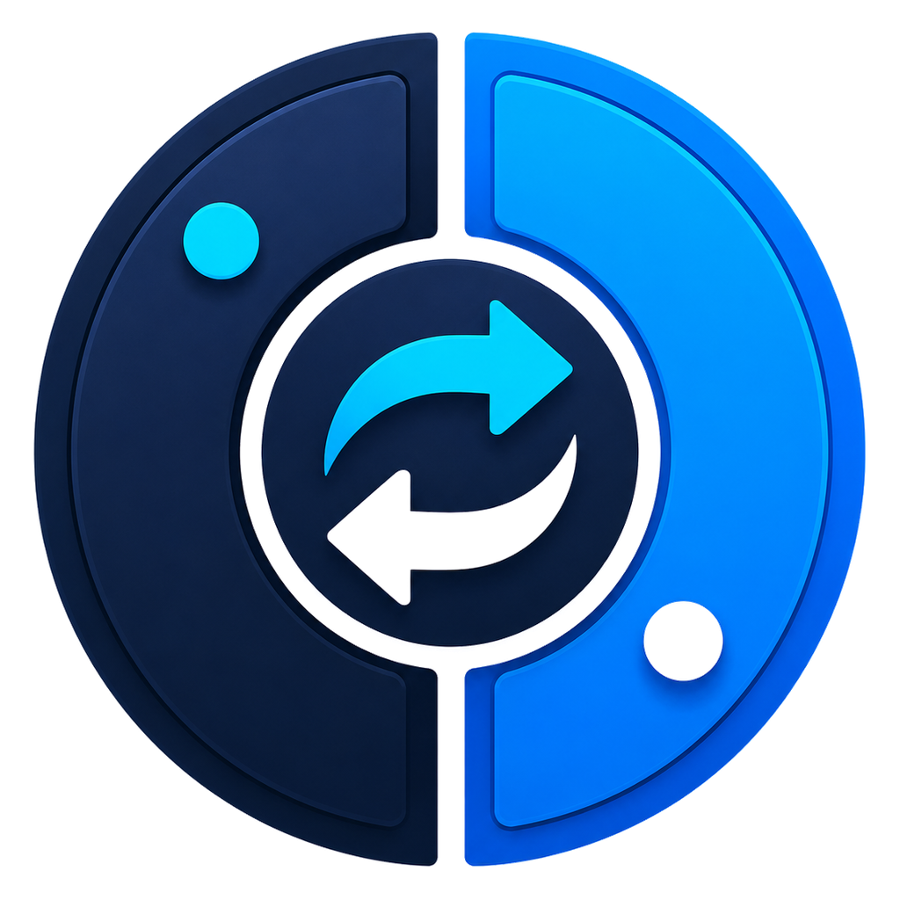
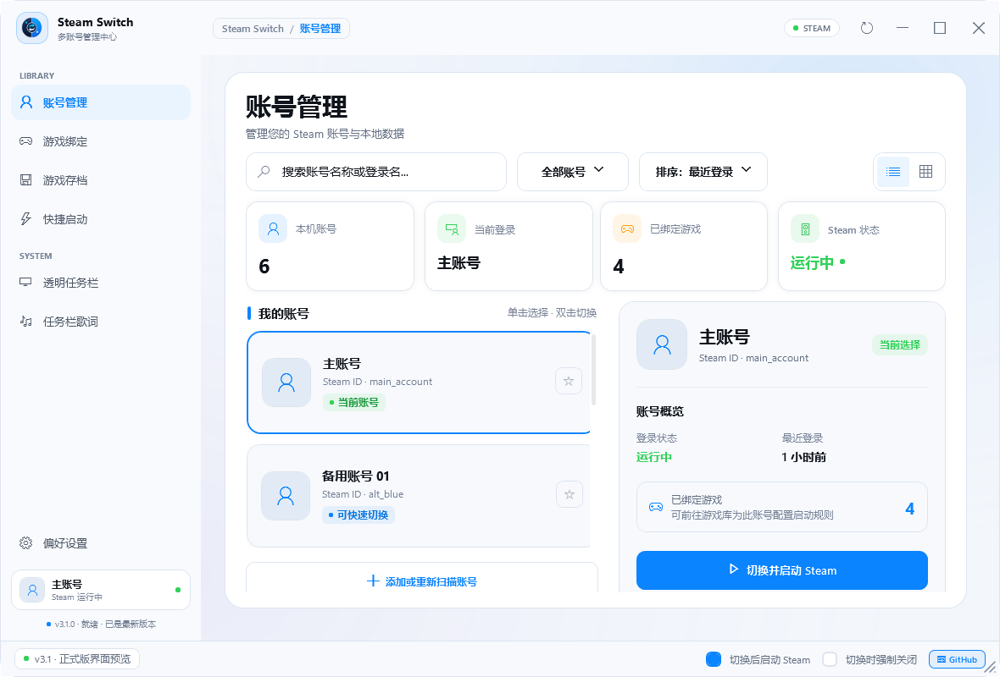
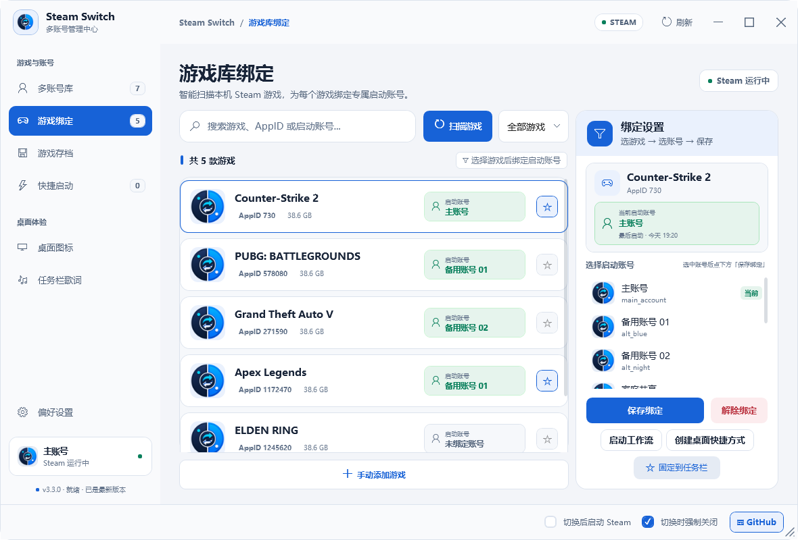
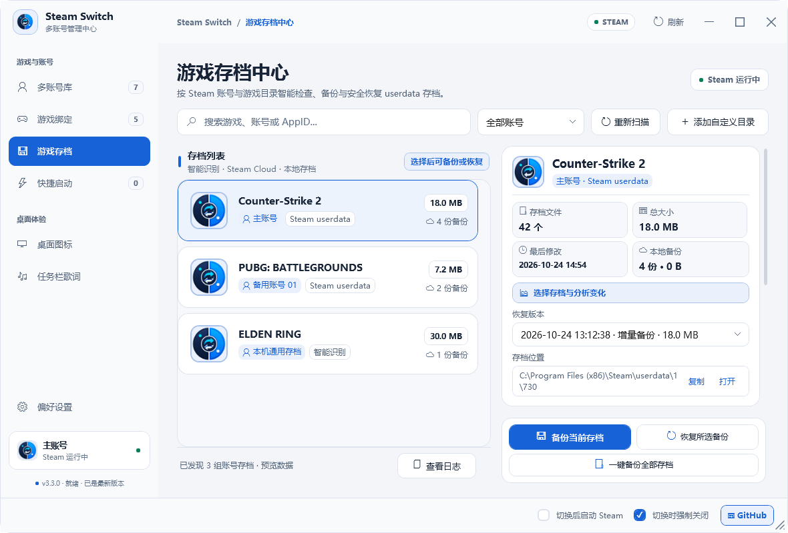
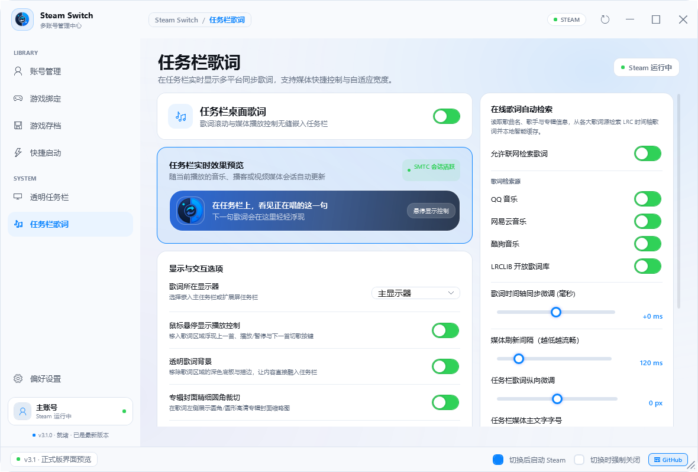
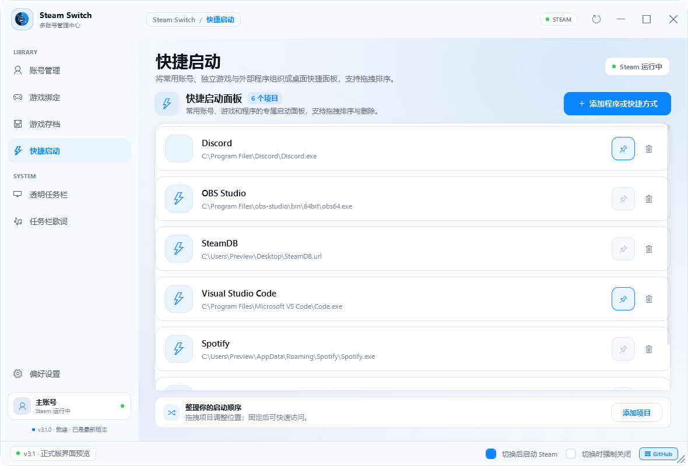
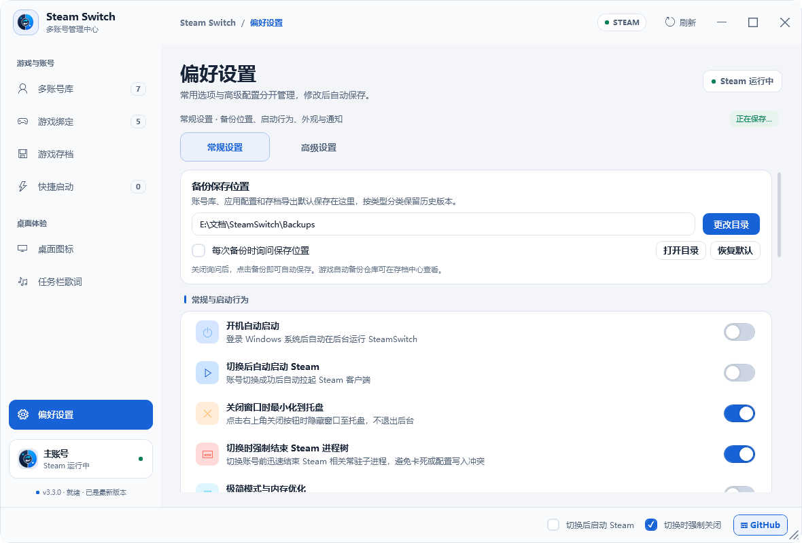

<div align="center">



# Steam Switch

**面向 Windows 的 Steam 多账号、游戏启动、任务栏歌词与存档管理工具**

[](https://github.com/ddxgtx/SteamSwitch/releases/tag/v3.3.0)
[](https://github.com/ddxgtx/SteamSwitch/releases/latest)
[](#系统要求)
[](https://dotnet.microsoft.com/)
[](LICENSE)

[下载正式版](https://github.com/ddxgtx/SteamSwitch/releases/latest) · [查看更新日志](CHANGELOG.md) · [反馈问题](https://github.com/ddxgtx/SteamSwitch/issues) · [功能建议](https://github.com/ddxgtx/SteamSwitch/discussions)

</div>

Steam Switch 将账号切换、游戏账号绑定、程序快速启动、任务栏媒体控制、桌面图标智能隐藏和游戏存档保护集中在一个本地应用中。程序不会保存 Steam 密码或 Steam Guard 密钥，主要功能无需修改游戏进程。

## 3.1 正式版

- 稳定的 Steam 账号读取、双击切换、强制重启切换和账号桌面快捷方式。
- 游戏扫描、账号绑定、启动参数及启动前/退出后存档工作流。
- 可嵌入任务栏的歌词、专辑封面、播放控制和账号/游戏快捷入口。
- 完整/增量存档备份、恢复前保护、SHA-256 校验、导入与导出。
- 桌面图标智能隐藏、异常退出恢复和低闪烁交互。
- 正式版与测试版更新渠道、安全下载域名检查和安装包完整性验证。

## 真实界面截图

下列图片由仓库内的 WPF 界面捕获工具直接渲染当前 `3.1` 代码生成，不是设计稿或 AI 合成图。

### 账号管理



账号搜索、筛选、排序和列表/网格视图均可直接操作。单击选择账号，双击立即切换；右侧显示当前账号、最近登录和绑定游戏。

### 游戏绑定与启动



扫描本机 Steam 游戏，为每款游戏指定启动账号，并复用统一的启动工作流、快捷方式和任务栏入口。

### 游戏存档中心



按账号和 AppID 隔离存档，支持智能路径识别、完整/增量备份、历史恢复、自动备份、校验、导入与导出。

### 任务栏歌词




通过 Windows 系统媒体会话读取曲名、歌手、封面和播放状态。支持在线 LRC、多歌词源、字体、双行文本、自适应宽度、透明背景、封面圆角、频谱和多显示器任务栏。

### 快速启动与设置





## 功能一览

| 模块 | 功能 |
|---|---|
| 账号管理 | 自动读取本机账号、头像和昵称；单击选择、双击切换；普通切换或强制重启 Steam；账号桌面快捷方式；托盘菜单 |
| 本地账号库 | Steam 裁剪 `loginusers.vdf` 后仍保留账号；已存档账号可搜索并直接切换，切换时自动还原到 `loginusers.vdf` |
| 游戏绑定 | 扫描已安装游戏；绑定默认账号；启动参数；大屏幕模式；启动前备份；退出后备份与关闭 Steam |
| 快速启动 | 添加程序、`.lnk`、`.url` 和常用目录；图标提取；固定到任务栏或桌面悬浮窗；拖动排序 |
| 任务栏常驻 | 账号头像、游戏 Logo、快速启动与歌词组合；左右/居中/自动定位；多显示器；尺寸、偏移、玻璃和圆角 |
| 任务栏歌词 | SMTC 媒体信息；QQ 音乐、网易云音乐、酷狗、LRCLIB；字体与字号；歌词偏移；透明背景；封面频谱；仅播放音乐时显示 |
| 桌面图标智能隐藏 | 智能、定时和手动模式；单击手动隐藏/取消隐藏；退出恢复；减少资源管理器刷新感 |
| 游戏存档 | Steam userdata、自定义目录和智能识别；完整/增量备份；去重；版本保留；校验；安全恢复；导入导出 |
| 桌面悬浮窗 | 账号、游戏与快捷入口；置顶、锁定、透明度、尺寸、玻璃颜色和圆角；不显示在 Alt+Tab |
| Steam 库注入 | 可选的 Steam CEF 本地注入，在游戏详情页提供绑定账号启动入口；默认关闭 |
| 更新与可靠性 | 稳定/测试渠道；GitHub 官方域名白名单；SHA-256 校验；配置原子写入及 `.bak` 恢复；单实例保护 |

## 下载与安装

### 安装版（推荐）

下载 [SteamSwitch-v3.3.0-win-x64-setup.exe](https://github.com/ddxgtx/SteamSwitch/releases/download/v3.3.0/SteamSwitch-v3.3.0-win-x64-setup.exe)。

- SHA-256：`287f41e727eec9130322925bf5c19bf53b61d795aff05abd4c84885118459e0e`

- 中文/英文安装向导。
- 内置 .NET 8 运行时。
- 可创建桌面快捷方式和开机自启。
- 安装与升级使用相同 AppId 和安装范围，可覆盖旧版。
- 程序本体按普通用户权限运行。

### 便携版

下载 [SteamSwitch-v3.3.0-win-x64-portable.zip](https://github.com/ddxgtx/SteamSwitch/releases/download/v3.3.0/SteamSwitch-v3.3.0-win-x64-portable.zip)，解压后运行 `SteamSwitch.exe`。

- SHA-256：`a30a367501b8f26ed40bf898cbf97d3d21e60cf38338e922da1661c22480507e`

> 安装包目前未进行商业代码签名，Windows SmartScreen 可能显示未知发布者。请只从本仓库 Release 下载，并核对 Release 中公布的 SHA-256。

## 系统要求

| 项目 | 要求 |
|---|---|
| 操作系统 | Windows 10 或 Windows 11，64 位 |
| Steam | 已安装桌面版 Steam 客户端 |
| 运行时 | 已打包 .NET 8，无需另行安装 |
| 网络 | 账号头像、在线歌词和自动更新需要；核心切换与本地备份可离线使用 |

## 快速开始

1. 启动 Steam Switch，程序会读取 Steam 的本机登录记录。
2. 在“账号管理”中选择账号，点击“切换并启动 Steam”，或直接双击账号卡片。
3. 进入“游戏绑定”扫描本机游戏，为常用游戏选择默认账号。
4. 按需固定账号、游戏和程序到任务栏常驻或桌面悬浮窗。
5. 在“游戏存档”中先创建一次手动备份，再开启自动备份策略。

## 存档安全设计

- 每个 ZIP 都包含独立清单，记录账号、AppID、相对路径、文件大小和 SHA-256。
- 恢复前先完整校验备份，再关闭 Steam，并为现有存档创建保护副本。
- 拒绝绝对路径、父目录跳转、重复文件、符号链接越界和身份不匹配备份。
- 增量备份保留完整基线依赖；单独导入缺少基线的增量包会被拒绝。
- 内容未发生变化时跳过重复备份；自动备份防重入并等待文件停止写入。

游戏存档默认保存在：`%USERPROFILE%\Documents\SteamSwitch Backups`

## 配置与日志

程序配置保存在：`%APPDATA%\SteamSwitch`

| 文件 | 内容 |
|---|---|
| `settings.json` / `settings.json.bak` | 设置与上一版本保护副本 |
| `accounts.json` / `accounts.json.bak` | 本地账号库，保存 Steam 已裁剪的账号 |
| `gamebindings.json` | 游戏与账号绑定及启动工作流 |
| `quicklaunch.json` | 快速启动项目和顺序 |
| `logs/steamswitch-YYYYMMDD.log` | 运行日志 |

配置使用临时文件落盘和原子替换；主文件损坏时会尝试读取 `.bak`。

“账号管理 → 账号档案”支持从本应用遗忘账号、恢复自动收录和导入/导出账号元数据。遗忘会一并清理本应用中的固定入口及账号游戏绑定，不删除 Steam 登录状态、游戏存档或备份。

设置页中的“导出设置”只导出偏好设置。“导出应用配置包”额外包含账号元数据、游戏绑定和快速启动；不包含密码、登录凭据或游戏存档文件。导入会先验证内容，再更新运行状态；写入或界面应用失败会回滚，异常中断会在下次启动时恢复。目录和程序路径可能需要在另一台机器上重新选择。

存档中心在源目录缺失时仍会列出可以安全识别的历史备份。所选差分版本可直接导出为自包含完整包；移除后重新添加的自定义存档，可在导入时核对原账号和路径，明确确认重新关联。

歌词来源变化会立即重新查询，无结果会在短时间后重试，也可通过任务栏组件右键菜单重新获取。只有窗口标题、没有 SMTC 播放进度时，组件显示曲目信息。

## Steam 库注入说明

库界面注入通过本机 Steam CEF 调试接口工作，默认关闭。它只为游戏详情页增加快捷启动入口，不修改游戏文件或游戏进程。由于 Steam 更新可能改变页面结构，若不需要此功能，账号切换、游戏绑定、快捷方式、任务栏和存档功能都可以独立使用。

> Steam Switch 是第三方开源工具，与 Valve Corporation 无关联。不用于作弊、绕过 DRM 或篡改游戏进程。请勿在 VAC/竞技游戏运行期间启用可选注入功能。

## 从源码构建

```powershell
git clone https://github.com/ddxgtx/SteamSwitch.git
cd SteamSwitch
dotnet restore SteamSwitch.sln
dotnet build SteamSwitch.sln -c Release -warnaserror
dotnet test SteamSwitch.sln -c Release
node tests/cef-session-regression.cjs
dotnet run --project tools/UiCapture/UiCapture.csproj -c Release -- artifacts/ui-smoke/settings.png settings-apply-smoke
```

生成 Windows x64 自包含版本：

```powershell
dotnet restore src\SteamSwitcher\SteamSwitcher.csproj -r win-x64
dotnet publish src\SteamSwitcher\SteamSwitcher.csproj -c Release -r win-x64 --self-contained true -p:PublishSingleFile=true
```

## 技术与来源说明

- .NET 8 / WPF / CommunityToolkit.Mvvm
- Hardcodet.NotifyIcon.Wpf
- Windows Win32 API 与 System Media Transport Controls
- Steam VDF 与可选 CEF DevTools 本地接口
- GitHub Releases API

账号快捷入口体验参考 [TcNo Account Switcher](https://github.com/TCNOco/TcNo-Acc-Switcher)，存档工作流参考 [Ludusavi](https://github.com/mtkennerly/ludusavi)。Steam Switch 的对应实现均为独立编写，详见 [THIRD_PARTY_NOTICES.md](THIRD_PARTY_NOTICES.md)。

## 贡献与许可证

欢迎通过 [Issues](https://github.com/ddxgtx/SteamSwitch/issues) 报告问题，或提交 Pull Request。

项目基于 **MIT License** 发布，完整条款见 [LICENSE](LICENSE)。你可以自由使用、修改和分发本软件，惟须保留原始版权声明与许可证声明。第三方组件的来源与许可关系记录在 [THIRD_PARTY_NOTICES.md](THIRD_PARTY_NOTICES.md)。

<div align="center">

**[下载正式版](https://github.com/ddxgtx/SteamSwitch/releases/latest)** · **[更新日志](CHANGELOG.md)** · **[问题反馈](https://github.com/ddxgtx/SteamSwitch/issues)**

如果 Steam Switch 对你有帮助，欢迎点一个 ⭐。

</div>
