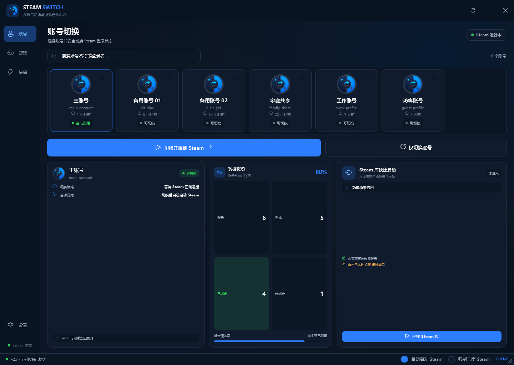
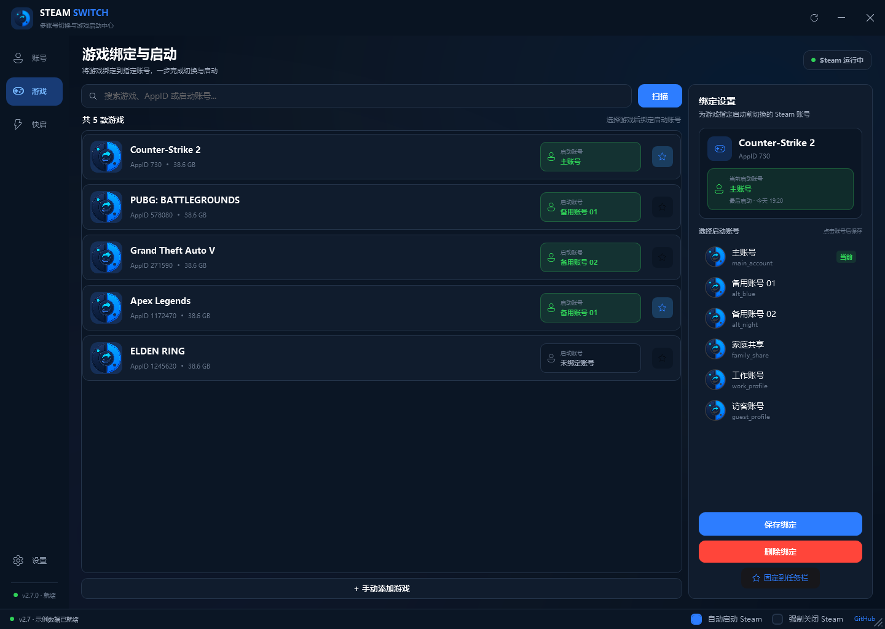
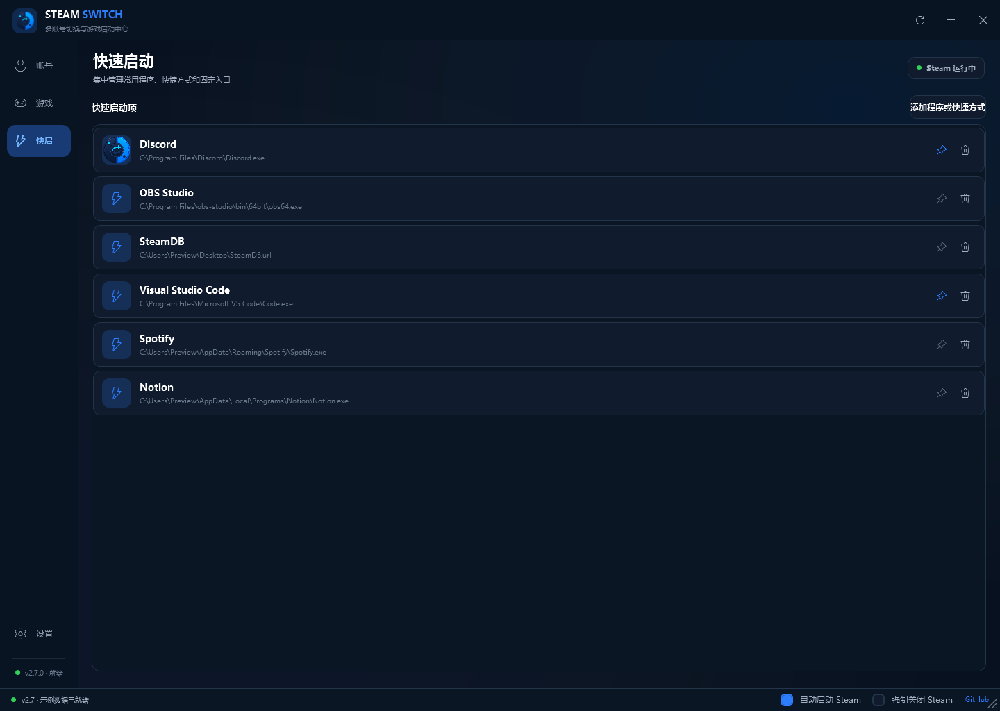
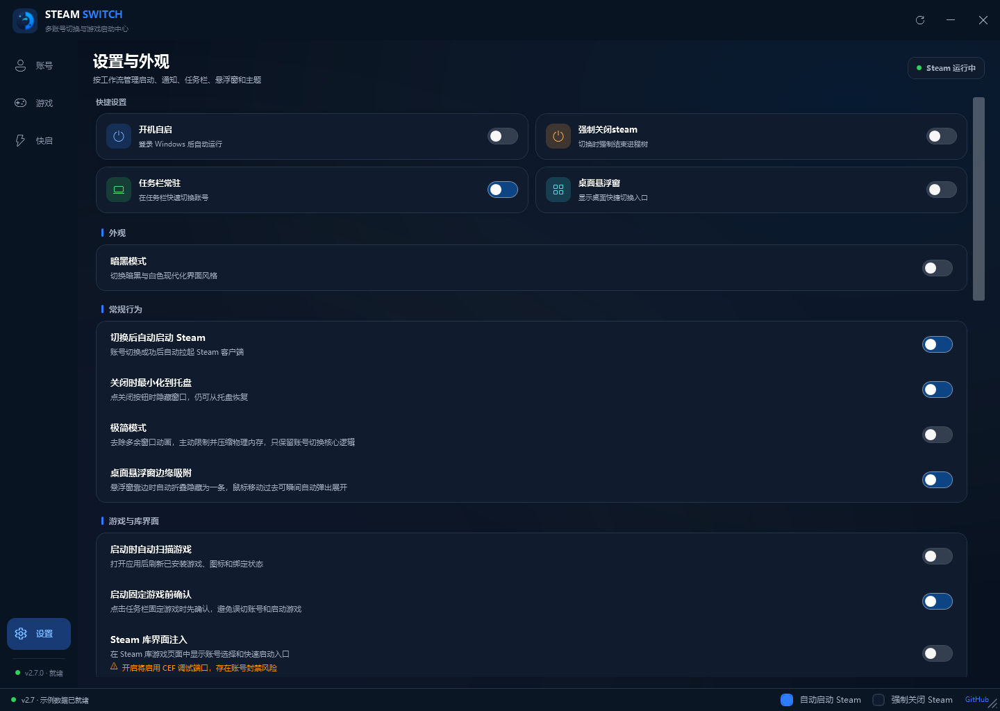
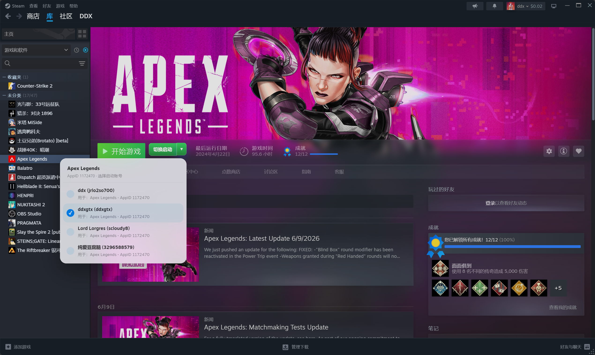

<div align="center">


# Steam Switch

**一站式 Steam 多账号管理工具**

快速切换账号 · 游戏账号绑定 · 程序快速启动 · 任务栏常驻 · 桌面悬浮窗 · Steam 库注入 · 自动更新

[](LICENSE)
[](https://dotnet.microsoft.com/)
[]()
[](https://github.com/ddxgtx/SteamSwitch/releases/tag/v3.0)
[]()

**[官方网站](http://ddxgtx.fun/SteamSwitch/)** · **[下载最新版](https://github.com/ddxgtx/SteamSwitch/releases/latest)** · **[问题反馈](https://github.com/ddxgtx/SteamSwitch/issues)**

</div>

---

## 截图预览

### 任务栏歌词

- 在任务栏账号切换区左侧显示同步歌词、歌曲名和歌手。
- 直接控制上一首、播放/暂停和下一首，兼容公开 Windows 系统媒体会话的播放器。
- 提供独立设置页、总开关、控制按钮开关、在线歌词开关和宽度调节。
- 在线歌词使用 [LRCLIB](https://lrclib.net/)；没有同步歌词或网络不可用时自动显示系统媒体信息。
- 设计参考 [Lyricify Lyrics Helper](https://github.com/WXRIW/Lyricify-Lyrics-Helper)，SteamSwitch 使用 Windows API 独立实现。

<div align="center">

**账号切换**


**游戏绑定**


**快捷启动**


**设置中心**


**Steam 库注入**


</div>

---

## 功能特性

### v3.0 测试版更新亮点

- 新增任务栏歌词、透明任务栏与桌面图标智能隐藏，并完善媒体封面、字体、频谱和透明样式。
- 新增游戏存档中心、自动/增量备份、完整性校验、智能路径识别和启动工作流。
- 新增账号与游戏桌面快捷方式，优化账号切换、双击交互、图标提取和游戏绑定体验。
- 全面优化设置页、滑动条、按钮比例、浅色/深色视觉层级及任务栏媒体布局。
- 修复歌词刷新闪烁、WPF 动画崩溃、任务栏透明重复启动、桌面图标恢复和多项资源生命周期问题。

<table>
<tr>
<td width="50%">

### 账号切换
- 自动读取 Steam 本机登录账号、昵称、头像
- 支持「切换并启动 Steam」与「仅切换账号」
- 为任意账号创建“切换并启动”桌面快捷方式
- 系统托盘菜单快速切换
- 最小化到托盘，支持无需 UAC 的开机自启
- 切换时显示气泡提醒

</td>
<td width="50%">

### 游戏绑定与启动
- 扫描本机已安装 Steam 游戏
- 为游戏绑定默认启动账号
- 固定常用游戏和快速启动项到任务栏/悬浮窗
- 启动前二次确认，避免误操作
- 高清游戏图标显示

</td>
</tr>
<tr>
<td width="50%">

### 任务栏常驻
- 将账号和游戏嵌入 Windows 任务栏
- 支持自动/左侧/中间/右侧定位
- 独立设置：液态玻璃、圆角、大小
- 独立“透明任务栏”标签页，支持透明、模糊、亚克力、纯色及最大化窗口动态效果
- X/Y 轴偏移调节
- 右键快捷菜单

</td>
<td width="50%">

### 桌面悬浮窗
- 可拖动的账号和游戏快捷入口
- 始终置顶、锁定位置、透明度调节
- 6 种玻璃颜色、液态玻璃效果
- 不出现在 Alt+Tab 中
- 独立设置，与任务栏分离

</td>
</tr>
<tr>
<td width="50%">

### Steam 库界面注入
- 在游戏详情页注入「切换启动」按钮
- 点击直接使用绑定账号启动
- 下拉箭头选择切换账号
- 绑定后按钮变为绿色标识

</td>
<td width="50%">

### 自动更新与主题
- 启动时自动检查 GitHub 最新版本
- 发现新版本弹窗提示，支持一键更新
- 暗黑/白色主题切换
- 设置自动保存（500ms 防抖）
- 窗口与后台任务退出时主动释放资源

</td>
</tr>
<tr>
<td width="50%">

### 游戏存档中心
- 按 Steam 账号与 AppID 检查 `userdata` 存档
- 可添加 userdata 之外的自定义存档目录，并关联指定账号或作为本机通用存档
- 支持单项备份和一键备份全部账号存档
- 支持选择历史版本及“恢复前保护”副本，覆盖前自动创建新保护备份
- 使用 SHA-256 校验备份完整性与账号归属
- 支持手动校验、删除历史备份及按类型自动保留最新版本
- 自动预览新增/修改/删除文件，内容未变化时跳过重复备份
- 自定义目录使用独立备份身份；目录暂时离线时仍保留历史并可恢复到原位置
- 可启用“Steam 退出后自动备份”；账号切换时会在登录信息变更前备份当前账号，普通退出则由后台状态检测触发
- 自动备份仅处理当前账号及本机通用目录，并要求文件可独占读取；仍被游戏占用的存档留待下次退出
- 恢复前安全关闭 Steam，降低 Steam Cloud 冲突风险

</td>
<td width="50%">

### 快速启动
- 集中管理程序、快捷方式与常用入口
- 支持固定到任务栏和桌面悬浮窗
- 拖拽排序与快速删除
- 与账号切换、游戏启动工作流独立使用

</td>
</tr>
</table>

---

## 下载安装

### 方式一：安装程序（推荐）

下载 **[SteamSwitch-v3.0-win-x64-setup.exe](https://github.com/ddxgtx/SteamSwitch/releases/download/v3.0/SteamSwitch-v3.0-win-x64-setup.exe)**

- 支持中文安装向导
- 可选创建桌面快捷方式
- 可选开机自启动
- 仅安装过程请求管理员权限，程序本体普通权限运行

### 方式二：解压版

下载 **[SteamSwitch-v3.0-win-x64-portable.zip](https://github.com/ddxgtx/SteamSwitch/releases/download/v3.0/SteamSwitch-v3.0-win-x64-portable.zip)**

- 解压到任意目录
- 运行 `SteamSwitch.exe`
- 无需安装，即开即用

### 系统要求

| 要求 | 说明 |
|------|------|
| 操作系统 | Windows 10 / Windows 11 (64-bit) |
| 运行时 | 已内置 .NET 8，无需另行安装 |
| 前置条件 | 已安装 Steam 客户端 |

---

## 使用指南

### 快速开始

```
启动 Steam Switch → 选择账号 → 点击「切换并启动 Steam」
```

### 绑定游戏账号

1. 打开「游戏」页 → 扫描本机游戏
2. 选择游戏 → 选择默认账号 → 点击绑定
3. 固定到快捷入口 → 一键启动

### Steam 库注入

1. 进入「设置」页 → 开启「Steam 库界面注入」
2. 打开 Steam 库 → 选择游戏
3. 在「开始游戏」旁看到「切换启动」按钮
4. 点击下拉箭头 → 选择账号 → 自动绑定并启动

### 任务栏/悬浮窗

1. 至少固定一个账号或游戏
2. 在设置页开启「任务栏常驻」或「桌面悬浮窗」
3. 调整位置、样式、效果

---

## 配置目录

程序数据保存在：`%APPDATA%\SteamSwitch`

设置文件采用原子替换并保留 `settings.json.bak` 上一版本；主设置不可读时会自动尝试恢复备份。

游戏存档备份默认保存在：`%USERPROFILE%\Documents\SteamSwitch Backups`

| 文件 | 说明 |
|------|------|
| `settings.json` | 应用设置、主题、布局配置 |
| `gamebindings.json` | 游戏与账号绑定关系 |
| `quicklaunch.json` | 快速启动项目与排序 |
| `logs/steamswitch-YYYYMMDD.log` | 运行日志 |

在设置页的「维护与排障」中可快速打开目录或重置布局。

### 透明任务栏功能来源

“透明任务栏”的透明、模糊、亚克力与动态模式功能灵感来源于 [TranslucentTB](https://github.com/TranslucentTB/TranslucentTB)（GPL-3.0）。SteamSwitch 基于 Windows 窗口组合 API 独立实现，未包含、复制或链接 TranslucentTB 的源码或二进制；完整说明见 [THIRD_PARTY_NOTICES.md](THIRD_PARTY_NOTICES.md)。检测到 TranslucentTB 已运行时，SteamSwitch 会自动暂停自身透明任务栏控制以避免冲突。

---

## 竞品对比与定位

| 项目 | 主要优势 | SteamSwitch 的取舍 |
|------|----------|--------------------|
| [TcNo Account Switcher](https://github.com/TCNOco/TcNo-Acc-Switcher) | 多游戏平台、快捷方式、协议/命令行、隐私模式 | 当前专注 Steam 深度工作流；已加入无密码桌面快捷切换，不保存 Steam Guard 密钥 |
| [Ludusavi](https://github.com/mtkennerly/ludusavi) | 大规模游戏规则库、多商店、自定义条目、备份预览与保留 | 当前优先保证 Steam 账号隔离；已加入自定义目录、差异预览、去重、历史恢复、校验和保留策略 |
| [GameSave Manager](https://www.gamesave-manager.com/) | 存档迁移、同步与计划任务 | 暂不在游戏运行期间强制定时复制，避免产生不一致备份；恢复采用校验后关闭 Steam、保护备份和原子替换 |
| [TranslucentTB](https://github.com/TranslucentTB/TranslucentTB) | 完整任务栏状态机与极低资源占用 | SteamSwitch 仅提供与账号快捷面板配套的常用外观模式，检测到官方程序时主动让出控制 |

账号快捷方式功能体验参考 TcNo Account Switcher，存档差异与保留工作流参考 Ludusavi。相关实现均为独立编写，来源与许可证说明见 [THIRD_PARTY_NOTICES.md](THIRD_PARTY_NOTICES.md)。

---

## 风险提示

> **Steam Switch 是第三方开源工具，与 Valve Corporation 无关联。**

- 「Steam 库界面注入」会开启 Steam CEF 调试端口
- 注入功能默认关闭，账号切换、游戏绑定和快捷入口均可独立使用
- 可能不符合 Steam 用户协议或未来平台策略
- **不用于**作弊、绕过 DRM、篡改游戏进程
- 不建议在 VAC/竞技游戏运行期间开启注入
- 如不能接受风险，请关闭注入功能，仅使用外部快捷入口

---

## 技术栈

| 技术 | 用途 |
|------|------|
| .NET 8.0 / WPF | 框架与 UI |
| CommunityToolkit.Mvvm | MVVM 架构 |
| Hardcodet.NotifyIcon.Wpf | 系统托盘 |
| Win32 API | 任务栏嵌入、窗口圆角 |
| Steam CEF DevTools | 库界面注入（可选） |
| VDF 解析 | Steam 配置读取 |
| GitHub API | 自动更新检查 |

---

## 从源码构建

```powershell
git clone https://github.com/ddxgtx/SteamSwitch.git
cd SteamSwitch
dotnet build SteamSwitch.sln -c Release
```

运行完整自动测试：

```powershell
dotnet test tests\SteamSwitcher.Tests\SteamSwitcher.Tests.csproj -c Release
```

或直接运行 `build.bat`

---

## 贡献

欢迎提交 Issue 和 Pull Request！

```powershell
git checkout -b feature/your-feature
# 修改代码
dotnet build SteamSwitch.sln -c Release
# 提交 PR
```

---

## 许可证

[MIT License](LICENSE) © [ddxgtx](https://github.com/ddxgtx)

---

## 致谢

- [Steam](https://store.steampowered.com/) - Valve Corporation
- [CommunityToolkit.Mvvm](https://github.com/CommunityToolkit/dotnet) - MVVM 框架
- [Hardcodet.NotifyIcon.Wpf](https://github.com/hardcodet/wpf-notifyicon) - 系统托盘图标

---

<div align="center">

**[官方网站](http://ddxgtx.fun/SteamSwitch/)** · **[下载](https://github.com/ddxgtx/SteamSwitch/releases)** · **[问题反馈](https://github.com/ddxgtx/SteamSwitch/issues)** · **[功能建议](https://github.com/ddxgtx/SteamSwitch/discussions)**

如果觉得有用，请给个 ⭐ Star 支持一下！

</div>
